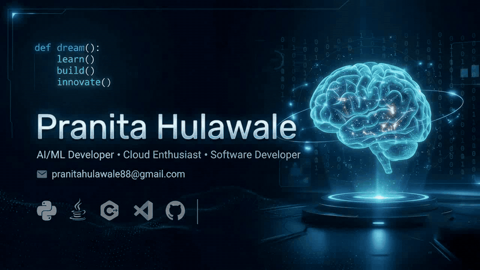

  

<h1 align="center">Hi, I'm Pranita Hulawale 👋</h1>

  <strong>Engineering Student | AI/ML Enthusiast | Developer</strong>

  Exploring the intersection of Artificial Intelligence, Software Development, and Cloud Computing.

---

## About Me

I am an engineering student with a strong interest in Artificial Intelligence, Machine Learning, and Software Development. I enjoy exploring new technologies, understanding how things work, and applying what I learn through hands-on projects.

My goal is to develop practical problem-solving skills and build meaningful applications that address real-world challenges. I believe in continuous learning, experimenting with new ideas, and improving through practical experience.

### Areas of Interest

- Artificial Intelligence and Machine Learning
- Web Application Development
- Cloud Computing and Cloud-Based Solutions
- Open-Source Development and Collaboration

### Currently Learning

- Python and Java
- Data Structures and Algorithms
- Machine Learning Concepts
- Cloud Technologies and AWS

Beyond technology, I enjoy sketching, listening to music, and exploring new places.

---

## 💻 Tech Stack

                   

---

## 📊 GitHub Stats

  
  

  

---

## 🌐 Connect With Me

  
  
  
  

---

## 🐍 Contribution Activity

  

  <i>Always learning. Always building. Always improving.</i>

---

## ✍️ Random Dev Quote

  

  

